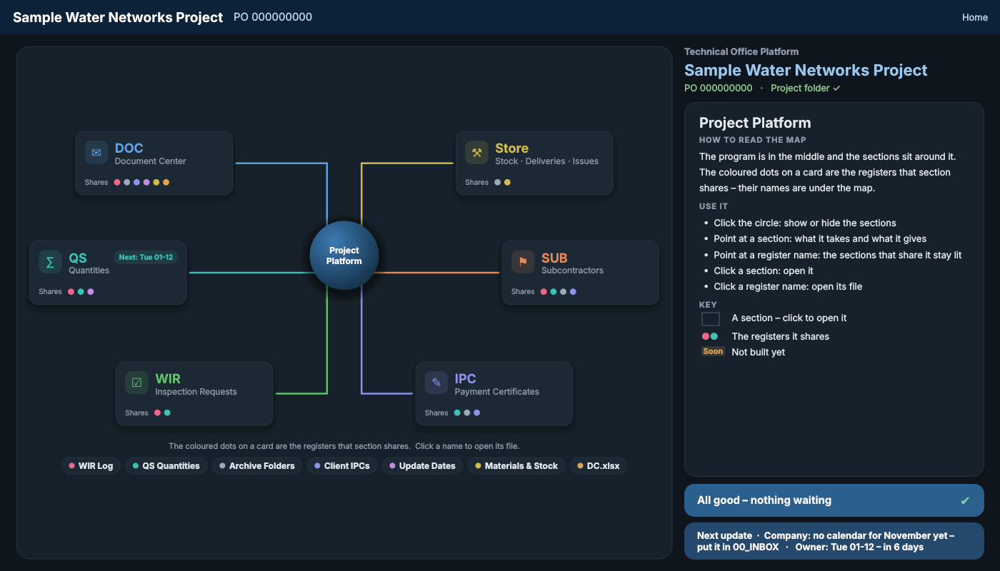
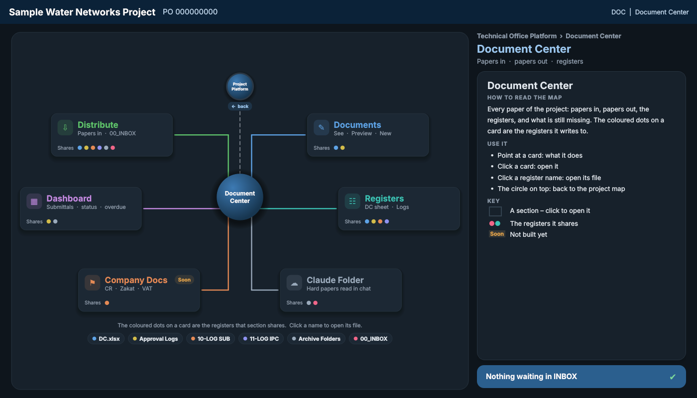

# Technical Office Platform

A desktop program that runs the day-to-day work of a construction **technical office** on water and sewer pipeline projects. It covers document control, inspection requests, material approvals, quantity surveying, subcontractor certificates and client payment certificates, all in one window.

I'm a civil engineer, not a professional developer. I built this with the help of Claude (Anthropic's AI) to replace hours of manual Excel and paperwork on a live infrastructure project. This repository is a cleaned, generic version: every project name, company, person, price and file path has been removed or replaced with sample values.



## What it does

| Section | What it handles |
|---|---|
| **DOC · Document Center** | Sorts incoming scanned papers from an inbox folder (rules + optional Claude reading), files them in the project archive, keeps the DC register, writes outgoing letters, builds submittal packages, dashboard of pending / overdue items |
| **WIR · Inspection Requests** | Works Inspection Request log (excavation, bedding, pipe laying, backfill, road base, asphalt) with status tracking and export |
| **QS · Quantities** | Takeoff from inspection requests: excavation by depth bands, bedding, backfill layers, road base, asphalt and milling, pipe lengths by diameter, charts and monthly / weekly updates |
| **Store / Materials** | Material approval (MAR) and material inspection (MIR) registers, deliveries, stock and issues |
| **SUB · Subcontractors** | Subcontractor certificates from QS rows, deductions and additions memos, final accounts, printable Arabic/English forms |
| **IPC · Payment Certificates** | Client interim payment certificates, variation sheets, summary sheets, automatic hourly update of the IPC workbook |



## Code map

An interactive map of every module, file and function in the program, with what each one does: [docs/code-map.html](docs/code-map.html) (download and open it in a browser).

## Folder layout it expects

The program works on a project folder (set `PROJECT_ROOT` in `SETTINGS.json`) organised like a typical technical office archive:

```
00_INBOX/            new scanned papers waiting to be distributed
04_Submittals/       MAR, MIR, shop drawings, method statements …
08_Cost_Payments/    client IPCs, subcontractor certificates
13_PARTIES/          one folder per subcontractor / supplier / plant / lab
```

## Run it

Requires Windows and Python 3.12.

```bash
pip install -r requirements.txt
copy SETTINGS.example.json ..\SETTINGS.json   # then edit project name, number and folder
python main_qt.py                              # or double-click RUN_QT.bat
```

Optional:
- **Tesseract OCR** (with Arabic data) for reading scanned papers.
- **Claude API key** (`ANTHROPIC_API_KEY`) for reading hard documents that the rules can't classify.

## Status and roadmap

The platform is in daily use on a real project. Next steps for the public version:

- [ ] Sample project folder with demo data so it runs out of the box
- [ ] Move remaining project-specific settings (rates, zones, form codes, signers) into one config file
- [ ] English translation of the code comments (most are in Arabic)
- [ ] Split into smaller reusable tools: WIR log, QS takeoff, bar bending schedule helper

Contributions and feedback from site and technical office engineers are very welcome.

## License

MIT, see [LICENSE](LICENSE).
